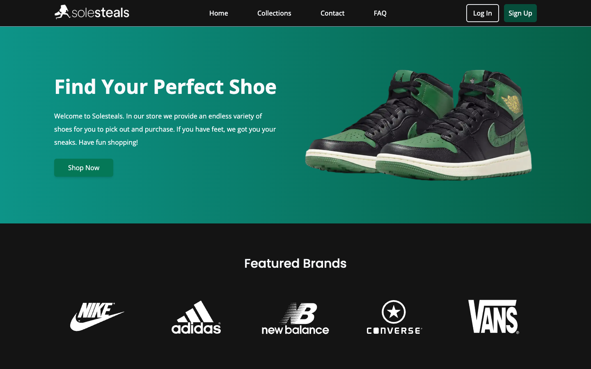
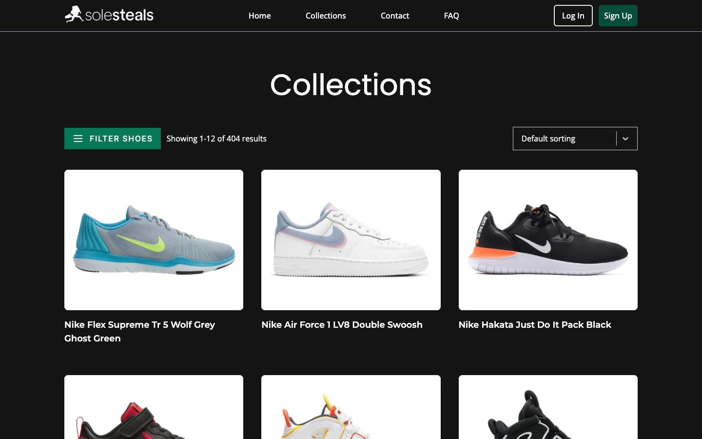

# Sole Steals

A sneaker store built with React, Vite and Firebase. Shoppers browse sneakers by brand, filter them, add sizes and colors to a cart, check out and track their orders. Built between October 2023 and January 2024.

**Live site:** https://solesteals.julianzaw.me





## Status

Complete for its scope. Shopping, checkout, orders and accounts all work against Firebase.

## What it does

- Browses sneakers by brand with search, gender, size and price filters and paginated results.
- Shows a product page with color, size and quantity pickers.
- Keeps a per-user cart in Firestore and shows the item count in the navbar.
- Checks out with a saved billing address and card, then creates an order with a tracking status.
- Lists past orders and shows each order's details.
- Handles accounts with Firebase Auth: sign-up, sign-in, email verification, password reset and email change.
- Lets a signed-in user edit account details, billing addresses and saved cards.

Saved cards are a demo. Enter test card numbers only.

## How it works

Firebase is the whole backend. Firebase Auth handles accounts. Firestore stores the catalog, with one collection per brand, and per-user data in the `users_cart`, `users_orders`, `users_billing` and `users_cards` collections. `PrivateRoute` keeps the dashboard, account, checkout and order pages behind sign-in.

## Tech stack

- React 18, React Router 6 and Vite
- Firebase Auth and Cloud Firestore
- Tailwind CSS and Framer Motion
- Vercel for hosting

## Run it locally

You need Node.js 18 or later and a Firebase project with Auth (email and password) and Firestore turned on.

1. Install the dependencies:

   ```bash
   npm install
   ```

2. Create `.env` with your Firebase web app config:

   ```bash
   VITE_FIREBASE_API_KEY=
   VITE_FIREBASE_AUTH_DOMAIN=
   VITE_FIREBASE_PROJECT_ID=
   VITE_FIREBASE_STORAGE_BUCKET=
   VITE_FIREBASE_MESSAGING_ID=
   VITE_FIREBASE_APP_ID=
   VITE_FIREBASE_MEASUREMENT_ID=
   ```

3. Start the dev server:

   ```bash
   npm run dev
   ```

The catalog reads from Firestore, so the shop is empty until you add sneaker documents under a brand collection.

## Project layout

```text
database/firebase.jsx            Firebase app, Auth and Firestore setup
src/components/authentication/   Sign-up, sign-in, verification and reset screens
src/components/main/             Dashboard, orders, billing and card settings
src/components/pages/            Home, collections, sneaker grid and details, cart, checkout, FAQ
src/contexts/                    Auth and cart-quantity contexts
src/utilities/                   Firestore reads and writes for cart, orders and payments
```
